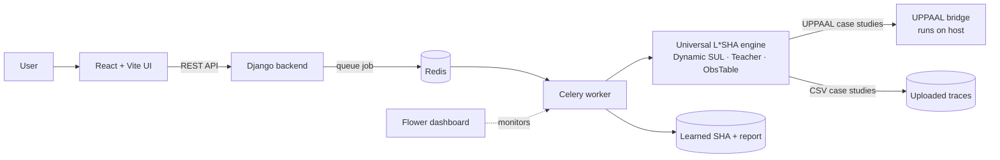

# LSHA-Framework

**A universal, configuration-driven web platform for learning Stochastic Hybrid Automata with L\*SHA.**

Describe a cyber-physical system in a JSON file, upload its data or simulation model, and get a learned model back, without writing a line of Python.


> Developed as my Master's thesis in Telecommunication Engineering at **Politecnico di Milano** (2026).

---

## Why this project exists

[L\*SHA](https://github.com/LesLivia/lsha) is an active automata-learning algorithm that builds **Stochastic Hybrid Automata (SHA)** from observed system traces. SHA are formal models of cyber-physical systems: discrete operating modes (heater on/off, machine idle/working) combined with continuous, stochastic physical behaviour inside each mode (temperature rising, operator fatigue growing).

The reference implementation was a research artefact. Every case study had its own hand-written `sul_functions.py`, with hard-coded column positions, thresholds, guard logic and flow-fitting code. Adding a new system meant copying hundreds of lines of Python and rewriting them.

**LSHA-Framework removes that step.** Everything that distinguishes one system from another is now supplied as **data**, not code:

| Before | After |
|---|---|
| One Python module per case study | One engine for every case study |
| Edit code to change variables, events or thresholds | Edit a JSON configuration |
| Run scripts from the terminal | Submit, monitor and inspect runs from a web UI |
| Local, manual setup | One-command Docker stack |

## Features

- **Declarative JSON schema** to describe any SHA-shaped system: variables and their roles, candidate flow models, events and guards, constants, and how traces are generated.
- **Dynamic System Under Learning** (`dynamic_sul.py`) that interprets the schema at runtime, replacing all per-case-study code.
- **Two trace sources** through the same pipeline: **UPPAAL** statistical model checking (simulation) or uploaded **CSV** logs from real machines.
- **Asynchronous learning jobs** with Celery and Redis, monitored live in the Flower dashboard.
- **React web interface** to define case studies step by step, upload data, browse built-in case studies and view results.
- **REST API** (Django REST Framework) for scripting and automation.
- **Built-in flow library:** constant, mean, linear, linear growth/decay, exponential growth/decay.

## Architecture



The same `Learner` / `Teacher` / `ObsTable` core runs for every case study. Only the JSON configuration and the input data change.

## Validated case studies

The engine reproduces the four industrial case studies of the original L\*SHA work with no code changes between them:

| Case study | System | Trace source |
|---|---|---|
| **THERMO** | Room thermostat: temperature driven by a heater switching on/off | UPPAAL |
| **HRI** | Human-robot interaction: operator fatigue during a collaborative task | UPPAAL and simulator logs |
| **ENERGY** | Real CNC machine: spindle power as a function of speed and pressure | CSV (production data) |
| **GREEN** | Olive-oil decanter centrifuge: bearing temperature behaviour | CSV (production data) |

All 26 shipped versions, with their JSON configurations, UPPAAL models and queries, are listed in [`docs/case-studies/`](docs/case-studies/README.md).

## Example configuration

A trimmed version of the thermostat case study ([full file](docs/case-studies/thermo/v1/)):

```json
{
  "case_study": "THERMO",
  "variables": [
    { "name": "T_r",  "role": "estimated", "type": "REAL" },
    { "name": "t.ON", "role": "driver",    "type": "INT" }
  ],
  "models": [
    { "id": 0, "name": "Heating", "type": "EXP_GROWTH" },
    { "id": 1, "name": "Cooling", "type": "EXP_DECAY" }
  ],
  "events": [
    { "symbol": "h_0", "model_id": 0, "guard": "t.ON == 1" },
    { "symbol": "c_0", "model_id": 1, "guard": "t.ON == 0" }
  ],
  "trace_generation": { "strategy": "UPPAAL" }
}
```

This says: *the room temperature `T_r` is the variable to learn; whenever the heater signal `t.ON` changes, a new segment starts; heating segments follow exponential growth and cooling segments follow exponential decay.* The learner then identifies the modes, the transitions between them, and the probability distributions of the flow parameters.

---

## Quick start

**Requirements:** [Docker Engine with the Compose plugin](https://docs.docker.com/engine/install/). UPPAAL 5.x on the host is only needed for the UPPAAL case studies (THERMO, HRI).

```bash
# 1. Clone with submodules (the L*SHA algorithm packages are git submodules)
git clone --recurse-submodules https://github.com/Rghaf/LSHA-Framework.git
cd LSHA-Framework

# 2. Configure
cp .env.example .env        # safe local defaults are pre-filled

# 3. Start everything: Redis, backend, worker, Flower, frontend, UPPAAL bridge
./run-stack.sh up --build
```

Already cloned without `--recurse-submodules`? Run `git submodule update --init --recursive`, otherwise the worker fails with `ModuleNotFoundError` when a learning task starts.

| Service | URL |
|---|---|
| Web UI (dev profile) | http://localhost:5173 |
| Web UI (prod profile) | http://localhost:80 |
| Backend API | http://localhost:8000 |
| Django admin | http://localhost:8000/admin |
| Flower (job monitoring) | http://localhost:5555 |

`run-stack.sh` wraps `docker compose`: it starts the UPPAAL bridge first and stops it when you press Ctrl-C. Every other subcommand (`down`, `logs`, `ps`, `exec`, …) is passed straight through to `docker compose`.

To use the Nginx production build instead of the Vite dev server:

```bash
COMPOSE_PROFILES=prod ./run-stack.sh up --build
```

### Watching a learning run

Learning runs inside the Celery worker, so its output isn't shown in the browser.

```bash
docker compose logs -f celery-worker     # live algorithm output
```

Or open **Flower** at http://localhost:5555 to see running tasks, arguments, runtimes, results and full tracebacks. Task history persists across restarts.

---

## UPPAAL support

UPPAAL 5.x's licence check crashes inside containers, so `verifyta` runs **natively on the host** and the backend reaches it through a small HTTP bridge in [`uppaal-bridge/`](uppaal-bridge/).

```bash
# Activate the licence once on the host
/opt/uppaal/lib/app/bin/verifyta -k <your-licence-key>
```

`./run-stack.sh up` starts the bridge automatically. To run it yourself, use `./uppaal-bridge/run-bridge.sh`. CSV case studies (ENERGY, GREEN) don't need UPPAAL at all. See [`uppaal-bridge/README.md`](uppaal-bridge/README.md) for the protocol and configuration.

## Project structure

```
LSHA-Framework/
├── backend/
│   ├── lsha_web/              Django project settings and Celery app
│   ├── rest_api/              REST API: case studies and CSV uploads
│   └── core_algorithm/
│       ├── dynamic_sul.py             JSON-driven System Under Learning
│       ├── dynamic_tracegenerator.py  UPPAAL and CSV trace generation
│       ├── teacher.py                 Model identification and hypothesis testing
│       ├── dynamic_obstable.py        Observation table
│       ├── tasks.py                   End-to-end Celery learning pipeline
│       └── lsha/, skg_connector/, …   Upstream L*SHA packages (git submodules)
├── frontend/                  React + Vite web interface
├── uppaal-bridge/             Host-side bridge to UPPAAL's verifyta
├── docs/
│   ├── THESIS_DOCUMENTATION.md    Full technical documentation
│   ├── CHAPTER_5_Implementation.md
│   └── case-studies/              All shipped case-study definitions
├── docker-compose.yml
└── run-stack.sh
```

### Services (`docker-compose.yml`)

- **redis**: Celery broker and result backend.
- **backend**: Django on `:8000`, the only service that runs migrations.
- **celery-worker**: runs the learning pipeline.
- **flower**: Celery dashboard on `:5555`.
- **frontend-dev** *(profile `dev`)*: Vite dev server with hot reload on `:5173`.
- **frontend-prod** *(profile `prod`)*: Nginx production build on `:80`.

Environment variables are documented in [`.env.example`](.env.example). Change `DJANGO_SECRET_KEY` and `UPPAAL_BRIDGE_TOKEN` before deploying anywhere other than your own machine.

## Upstream algorithm packages

The learning core is pulled in as git submodules, pinned to these commits:

| Path (`backend/core_algorithm/…`) | Upstream | Commit |
|---|---|---|
| `lsha` | [LesLivia/lsha](https://github.com/LesLivia/lsha) | `bea16c0` |
| `autotwin_automata_learning` | [AutotwinEU/autotwin_automata_learning](https://github.com/AutotwinEU/autotwin_automata_learning) | `c9c4ce3` |
| `sha2dt_semantic_mapper` | [LesLivia/sha2dt_semantic_mapper](https://github.com/LesLivia/sha2dt_semantic_mapper) | `3343a8b` |
| `skg_connector` | [LesLivia/skg_connector](https://github.com/LesLivia/skg_connector) | `4d6d13f` |

## Documentation

- [**Thesis documentation**](docs/THESIS_DOCUMENTATION.md): theory, case-study physics, the JSON schema, every engine component, and worked examples.
- [**Implementation chapter**](docs/CHAPTER_5_Implementation.md): how the hard-coded scripts became a configurable architecture.
- [**Case studies**](docs/case-studies/README.md): every shipped configuration, ready to submit to `POST /api/case-study/`.

## Limitations and future work

- One estimated (learned) variable per case study; multi-output systems would need the dynamic SUL generalised.
- The flow-model catalogue is fixed; a plugin registry would make new flow types easier to add.
- Variables must be declared manually; auto-detecting roles from an uploaded CSV is a natural next step.
- Missing columns currently produce warnings instead of failing fast.

See [Section 14 of the thesis documentation](docs/THESIS_DOCUMENTATION.md#14-limitations-and-future-work) for the full list.

## Acknowledgements

L\*SHA was created by Livia Lestingi, Marcello M. Bersani and Matteo Rossi at Politecnico di Milano. This project builds on their [original implementation](https://github.com/LesLivia/lsha) and the [AUTO-TWIN](https://github.com/AutotwinEU) automata-learning packages.

## Author

**Reza Ghadiri**, [GitHub](https://github.com/Rghaf) · [LinkedIn](https://www.linkedin.com/in/rghaf/)
